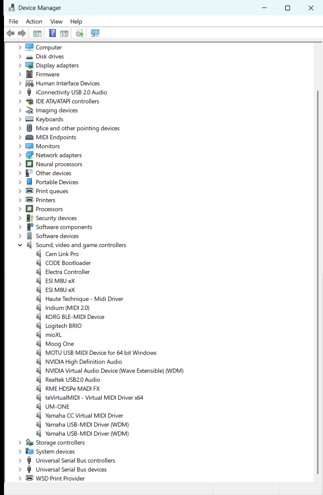
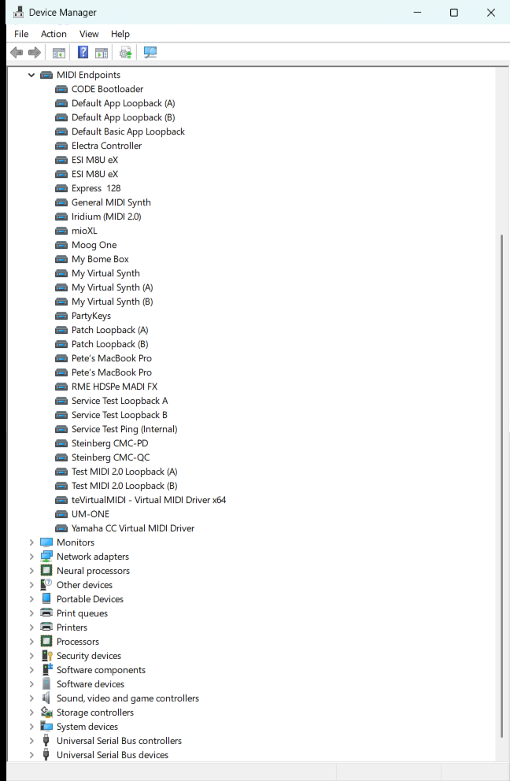
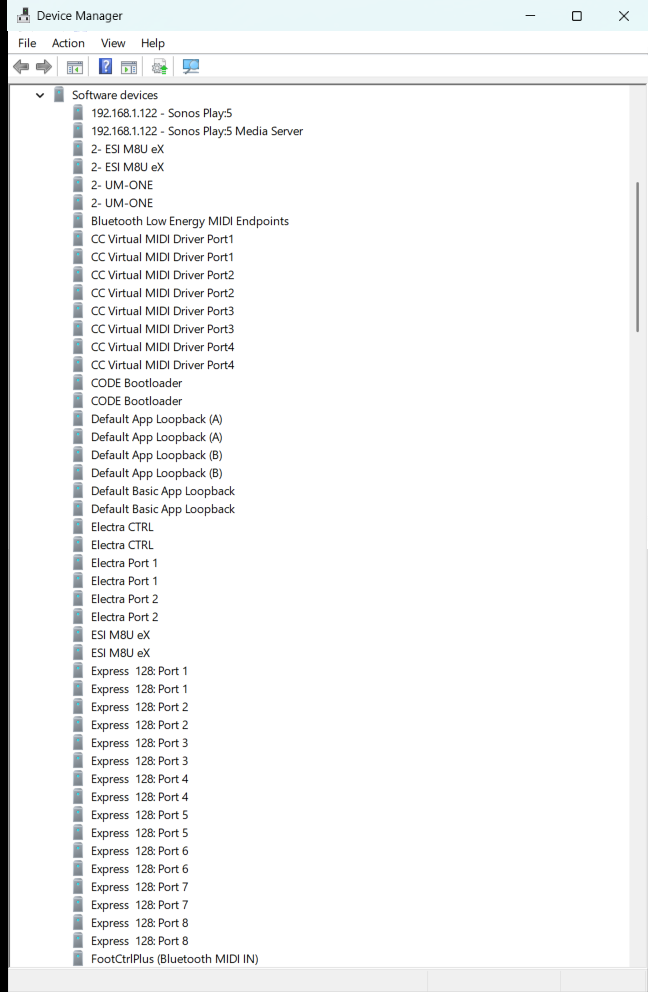

If you open Device Manager on a PC with Windows MIDI Services, you'll find a lot more MIDI entries than you might expect. Some have names that look like duplicates. Some have names like "Service Test Ping (Internal)" that don't sound like anything you plugged in. It's tempting to tidy them up by disabling the ones you don't recognize.

Please don't. Almost all of these entries are software devices. Windows creates them on purpose, every time it starts, so that apps can find and use your MIDI gear. Disabling one can stop the MIDI service from starting, hide your devices from your apps, or break MIDI in ways that are hard to track down.

This article walks through the three places MIDI shows up in Device Manager, what each entry is for, and the one place where it *is* fine to disable something.

## Where MIDI shows up

| Device Manager section | What's in it | Who creates it | OK to disable? |
| --- | --- | --- | --- |
| **Sound, video and game controllers** | Your real MIDI and audio hardware, and driver-based virtual MIDI devices | The device's driver | **Yes.** This is the place to turn a device off. |
| **MIDI Endpoints** | One MIDI endpoint for each device, loopback, network host, and so on | The MIDI service (`midisrv`) | **No** |
| **Software devices** | Parent devices for each kind of MIDI connection, plus the MIDI 1.0 input and output ports | The MIDI service and the Windows audio service | **No** |

The short version: if you don't want Windows to use a MIDI device, disable it under **Sound, video and game controllers**, and leave everything else alone. The rest of this article explains why.

## Sound, video and game controllers

This is where the actual devices live. You'll see entries for things like:

- USB MIDI keyboards, controllers, and interfaces
- Audio interfaces that also have MIDI ports
- Virtual MIDI drivers you installed, like loopMIDI, teVirtualMIDI, or a manufacturer's virtual port driver
- Audio devices that have nothing to do with MIDI, like your speakers or your webcam's microphone

Each of these has a real driver behind it. Some devices show up here twice, once for audio and once for MIDI, because the manufacturer ships a separate driver for each. That's normal.



**If you don't want a device to be used, disable it here.** Right-click the device and choose **Disable device**. Windows MIDI Services sees that the device is gone and removes its MIDI endpoint and its MIDI 1.0 ports for you. When you enable it again, they come back.

You can also switch a USB MIDI device to a different driver from here. See [How to switch between MIDI class drivers]({{ site.baseurl }}/kb/how-to-switch-between-class-drivers/).

## MIDI Endpoints

This section is new with Windows MIDI Services. Each entry is a MIDI endpoint, which is what apps that use the new Windows MIDI Services API connect to. Most of the time there's one endpoint for each device. A USB keyboard under **Sound, video and game controllers** will have a matching endpoint here, usually with the same name.

You'll also see endpoints that don't match any hardware:

- **Loopbacks** you created with the MIDI Settings app, like the default "Test MIDI 2.0 Loopback (A)" and "(B)" pair
- **Network MIDI 2.0** devices and hosts
- **Bluetooth LE MIDI** devices, when you've set them up through Windows MIDI Services
- **Virtual devices** that an app has created while it's running
- The **MIDI 2.0 synthesizer**, if you have it installed
- **Service Test Loopback A**, **Service Test Loopback B**, and **Service Test Ping (Internal)**

Those last three are always there. The MIDI service uses them to check that it's working, and our own tools and tests depend on them. Most music apps never show them, so you won't see them in your DAW.



The MIDI service creates every entry in this section. **Don't disable them.** If you disable an endpoint, apps can't use that device, and some tools will report that the MIDI service isn't working. Disabling one of the Service Test entries can make the MIDI service fail its own startup checks.

If you want to hide a loopback or a network device you no longer use, remove it in the [MIDI Settings app]({{ site.baseurl }}/tools/settings/) instead.

## Software devices

The **Software devices** section holds entries that Windows creates in software, not drivers for hardware. Lots of Windows features put things here, so not everything you see is MIDI. The MIDI entries fall into two groups.

### Parent devices for each kind of MIDI connection

The MIDI service creates one parent device for each kind of connection it supports. The endpoints for that kind of connection hang off it, like branches from a trunk. On a typical PC you'll see some of these:

| Name in Device Manager | What it's for |
| --- | --- |
| MIDI 2.0 Service Tests | The parent of the three Service Test endpoints |
| MIDI 2.0 Loop Devices | The MIDI 2.0 loopbacks you create in MIDI Settings |
| MIDI 1.0 Basic Loopback Devices | The basic MIDI 1.0 loopbacks |
| MIDI 2.0 Virtual Devices | Virtual devices that apps create |
| MIDI Synthesizers | The MIDI 2.0 General MIDI synthesizer |
| Bluetooth Low Energy MIDI Endpoints | Bluetooth LE MIDI devices |
| MIDI 2.0 Network Remote Hosts | Network MIDI 2.0 devices on other computers or hardware |
| MIDI 2.0 Network Local Host: *name* | Each Network MIDI 2.0 host you set up on this PC |
| RTP-MIDI Endpoints | RTP-MIDI (Apple network MIDI) sessions |

Which ones you have depends on what's installed. Bluetooth LE MIDI, Network MIDI 2.0, RTP-MIDI, and the synthesizer only show up if you've installed them.

**Don't disable these.** If you disable a parent, every endpoint under it goes away too. Disabling **MIDI 2.0 Service Tests** in particular can keep the MIDI service from starting correctly.

### MIDI 1.0 input and output ports

Older apps, and apps that use the MIDI 1.0 APIs in Windows, don't connect to endpoints. They connect to MIDI 1.0 ports, the familiar "In" and "Out" ports you've always picked from a list. When the MIDI service sets up an endpoint, the Windows audio service creates a software device for each of its MIDI 1.0 ports.

That's why you'll often see two entries with exactly the same name, like this:

```text
CC Virtual MIDI Driver Port1
CC Virtual MIDI Driver Port1
```

They aren't duplicates. One is the input port and the other is the output port. A device with eight inputs and eight outputs will add 16 entries here.



**Don't disable these either.** If you do, apps that use MIDI 1.0 won't see that port.

## What about Settings > Bluetooth & devices?

The Windows Settings app can show some of the same software devices under **Bluetooth & devices**. The same advice applies. Don't remove or turn off MIDI software devices there. If you want to stop using a Bluetooth LE MIDI device, use **Forget** in the [MIDI Bluetooth Setup app]({{ site.baseurl }}/tools/midibluetoothsetup/). To stop using any other device, disable it under **Sound, video and game controllers** in Device Manager.

## Why there are so many

Windows MIDI Services lets more than one app use the same device at the same time, supports both MIDI 1.0 and MIDI 2.0 apps, and adds new kinds of connections like loopbacks, network MIDI, and Bluetooth. Each of those needs its own entry so apps can find it. One USB keyboard can end up with a device, an endpoint, and a handful of MIDI 1.0 ports. That's by design, and it all comes from the information the device and its driver give to Windows. You didn't do anything wrong, and nothing needs cleaning up.

## If you already disabled something

1. Open Device Manager.
2. Choose **View** > **Show hidden devices**, so entries that aren't working right now still show up.
3. Look in **Software devices** and **MIDI Endpoints** for entries with a small down arrow on the icon. That arrow means the device is disabled.
4. Right-click each one and choose **Enable device**.
5. Restart your PC, so the MIDI service starts fresh and recreates anything that's missing.

If you used **Uninstall device** on one of these software devices instead of disabling it, restarting your PC is usually enough. The MIDI service and the audio service create these entries again when they start.

If MIDI still isn't working after that, the [MIDI Troubleshooting and Repair app]({{ site.baseurl }}/tools/miditroubleshooter/) can check the MIDI service and your devices for you.
